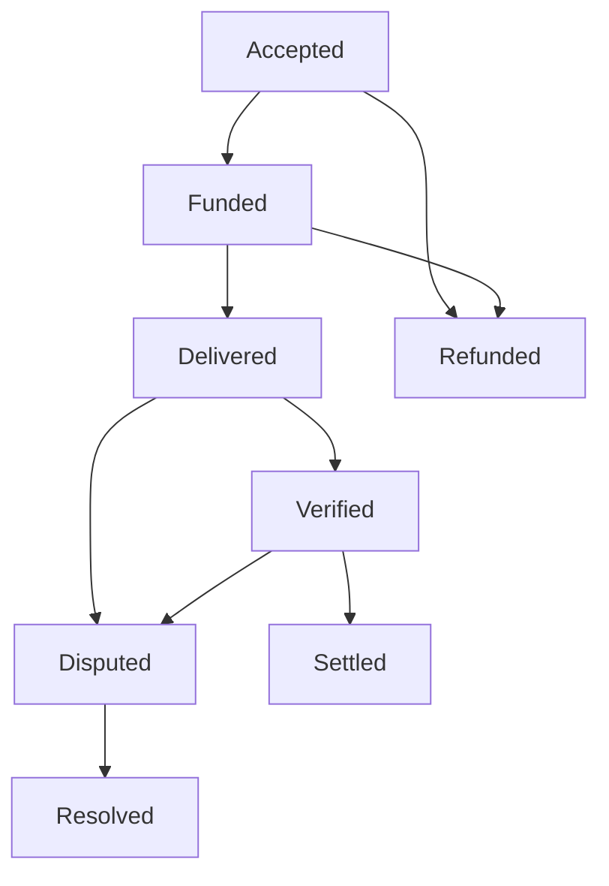

# Symbolon

**An experimental contract, verification and evidence core for machine work.**

[Repository](https://github.com/Albertito-AI/symbolon) · [Development issues](https://github.com/Albertito-AI/symbolon/issues) · [Documentation](#documentation)

Symbolon explores how a business can specify a bounded task, record its delivery,
check agreed acceptance conditions and retain an inspectable payment decision.
The first implementation is a local sandbox for structured data work. It uses
synthetic **TEST** units and requires no accounts, API keys, blockchain or network
connection to run.

Version **0.1.0a1** is a working reference implementation, not a deployed
marketplace. The [enhanced report](docs/enhanced-report.md) develops the product
and commercial case. The [source audit](docs/source-audit.md) records corrections
to the founding research and bounds what the evidence establishes.

## Run the demonstration

Requirements: Python 3.11 or later. There are no runtime or test dependencies
outside the Python standard library.

```bash
git clone https://github.com/Albertito-AI/symbolon.git
cd symbolon
PYTHONPATH=src python -m symbolon demo --output artifacts/first-run
PYTHONPATH=src python -m unittest discover -s tests -v
PYTHONPATH=src python -m symbolon economics
```

This public repository contains the experimental reference implementation.
The [public release plan](docs/public-release-plan.md) records its development
and staged launch approach.

On Windows PowerShell, first run `$env:PYTHONPATH = "src"`, then use the same
`python -m ...` commands without the `PYTHONPATH=src` prefix. Alternatively,
`python -m pip install -e .` installs the `symbolon` command.

The demonstration creates two fixture contracts. One passes its fixed reference
check and settles after the challenge window. The other has an incorrect total,
enters dispute and is resolved by refunding the task price and returning the
bond. Every transfer is in non-redeemable TEST units. Example actor names and
timestamps are synthetic.

The output contains the contract envelope, two evidence bundles, their SHA-256
digests and a summary. A new run refuses to overwrite existing demonstration
files. To verify a saved bundle, use a digest retained separately from that bundle:

```bash
PYTHONPATH=src python -m symbolon verify-bundle artifacts/first-run/accepted-evidence.json --expected-sha256 YOUR_RETAINED_DIGEST
```

A digest stored beside the bundle is convenient for a demo but is not an
independent trust anchor. A party that can replace both can fabricate history.

## Implemented in this version

| Area | Behaviour |
| --- | --- |
| Contract | Strict dated envelope, accepted output digest, named local roles, price, bond and deadlines |
| Accounting | Atomic SQLite transactions; balanced postings; derived balances; overdraft checks; conflicting retries rejected |
| Workflow | Funding, delivery, comparison, challenge, settlement, nondelivery refund and explicit dispute resolution |
| Verification | One bounded invoice profile; field and type checks; unique lines; arithmetic; exact fixture comparison |
| Evidence | Snapshot digest; event and journal chains; replayed state; transfer reconciliation; reproduced invoice checks |
| Economics | Audit and collateral illustration with false positives, feasibility floor, capital limit and numeric validation |
| Tests | Unit, integration, concurrency and targeted adversarial tests using `unittest` |

The current contract acceptance rule, `exact-json-v1`, checks equality to an
already known reference. The invoice report adds structural checks. Passing
these checks does not establish that an invoice is genuine or that its debt is
owed. A source-backed extraction profile is the next product milestone.



Settlement requires a successful reference check and an expired challenge
window. Unverified work never settles by silence. Failure opens a dispute;
it does not automatically confiscate collateral. Nondelivery refunds the price
and returns the bond in this sandbox.

## Trust and operating boundary

The caller supplies local actor labels and time. There is no network identity
verification, signature verification, operator onboarding or real payment
adapter. Direct database access is trusted administration. Append-only SQL
triggers and hashes detect some inconsistencies; they do not defeat a malicious
administrator who controls the whole database and all checkpoints.

Evidence exports contain the complete synthetic journal and must not be used to
export a shared customer ledger. The [architecture](docs/architecture.md) and
[security policy](SECURITY.md) describe these limits. A2A, MCP, x402, MPP and card
integrations are planned interfaces, with conformance work still required.
There is no TLA+ model or claim of formal verification in this release.

## Development and commercial plan

Start with one buyer segment and one measurable acceptance profile. Test review
time, defect detection and fully costed delivery against the buyer's existing
process. The [commercial plan](docs/commercial-plan.md) defines proposed gates
for interviews, labelled cases, independent users, paid pilots and repeat work.
The [roadmap](docs/roadmap.md) turns remaining work into reviewable issues.

## Build Symbolon with us

We welcome co-creators who want to improve how machine work is specified,
checked and handed over. Start by reproducing the demonstration, reporting
friction or discussing one bounded improvement:

- [Reproducibility and the implementation matrix](https://github.com/Albertito-AI/symbolon/issues/9): check the quick start and connect requirements to code and meaningful tests.
- [Versioned acceptance profiles](https://github.com/Albertito-AI/symbolon/issues/2): help define good, defective and indeterminate structured-data cases.
- [Selective portable evidence](https://github.com/Albertito-AI/symbolon/issues/3): explore evidence that a recipient can inspect without receiving unrelated records.

Use the existing issue before starting substantial work and read
[CONTRIBUTING.md](CONTRIBUTING.md). Reviewed contributions retain their authorship,
and release notes will credit the people who contributed to that release.
We also welcome proposals for funded collaborations. Agree the scope, roles,
intellectual-property arrangements, payment terms and support responsibilities
in writing before starting paid work.

### Documentation

- [Enhanced project report](docs/enhanced-report.md)
- [Source audit and primary references](docs/source-audit.md)
- [Architecture and evidence format](docs/architecture.md)
- [Economic model and limitations](docs/economics.md)
- [Legal design questions](docs/legal-design.md)
- [Commercial validation plan](docs/commercial-plan.md)
- [Public release and market entry plan](docs/public-release-plan.md)
- [Continuous improvement](docs/continuous-improvement.md) and [improvement log](docs/improvement-log.json)
- [Roadmap](docs/roadmap.md) and [design decisions](docs/decisions.md)
- [Release validation](docs/validation.md)
- [Research provenance](docs/provenance.md)
- [Contribution guide](CONTRIBUTING.md), [governance](GOVERNANCE.md) and [licence](LICENSE)

**Project owner:** Albert Tan Sin Hon, GitHub `Albertito-AI`.
Symbolon is a working project name. Trademark clearance and commercial branding
have not been completed. The reference implementation is licensed under
Apache-2.0; no commercial service or financial commitment is created by this
repository.


